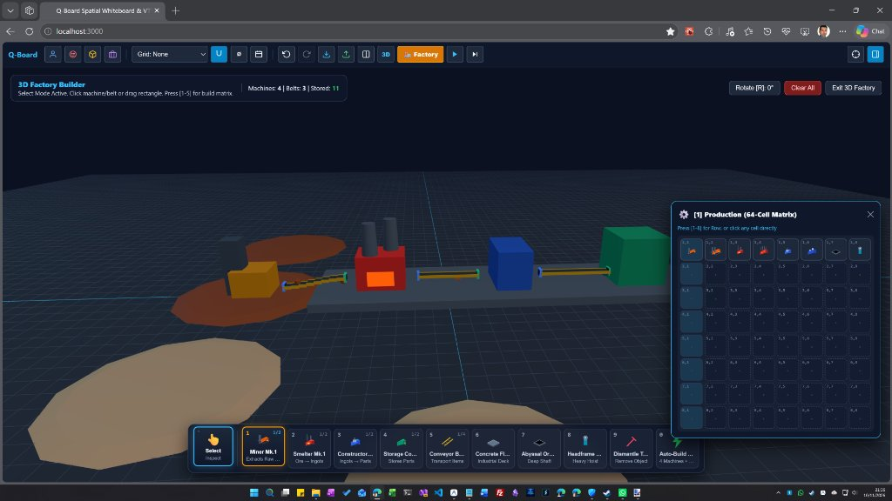
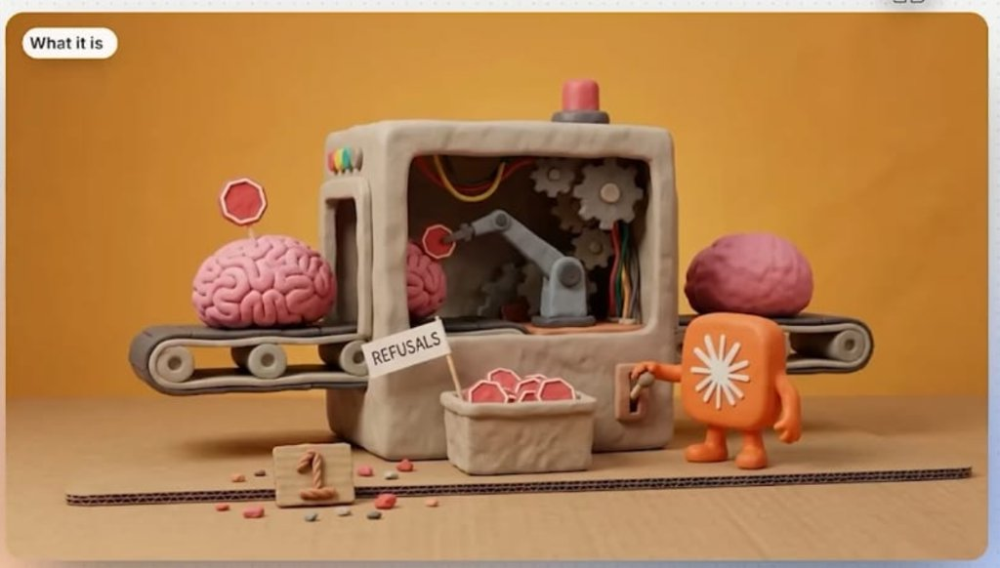
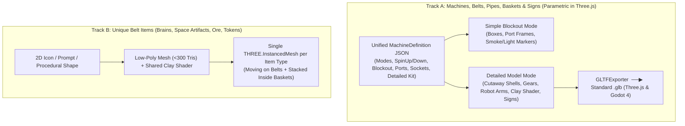

# Tailored 3D Asset & Machine Automation Blueprint for `Building-101-Game`

Seeing both the running **Simple Blockout Prototype** (`prototype-blockout-mode.jpg`) and the target **Tactile Cutaway Machine Concept** (`concept-cutaway-diorama-mode.jpg`) alongside [`QFactoryModelBuilder.ts`](file:///f:/Dev/building-101-game/src/core/QFactoryModelBuilder.ts) and [`QFactory3DScene.ts`](file:///f:/Dev/building-101-game/src/core/QFactory3DScene.ts) defines a clean two-stage rendering pipeline:

1. **Simple Blockout Mode** for fast layout, port alignment, smoke/light point verification, and multi-mode simulation testing.
2. **Detailed Model Mode** generated from parametric shapes + procedural clay/space-matte textures (and exportable to `.glb` for Three.js & Godot 4).

---

## 1. Deconstructing the Detailed Machine Style (Under 1,500 Triangles)

| Visual Element in Reference | How to Build It Light & Automated in Three.js | Est. Triangles |
|---|---|---|
| **1. Soft Tactile "Clay / Molded Space Composite" Look** | Beveled shapes (`ExtrudeGeometry` / `RoundedBoxGeometry`, 2 bevel segments) + **1 shared procedural 512×512 Clay/Thumbprint Normal & Roughness map** (`roughness: 0.88`, warm hemisphere light). | `~180–350 tris` |
| **2. Open Cutaway Window Chassis** | Extrude a 2D `THREE.Shape` (rounded outer rectangle) with a `THREE.Path` **hole** (rounded inner window) + side belt portals + recessed back wall. Zero messy CSG booleans needed. | `~220 tris` |
| **3. Whirring Interior (Gears, Robotic Arm, Dangling Wires)** | Reusable parametric parts: extruded 2D cog shapes (`speed2 = -speed1 * teeth1/teeth2`), 3-pivot robotic arm (`turret -> lowerArm -> upperArm -> claw`), and 5-sided `TubeGeometry` along `CatmullRomCurve3` splines for colored wires. | `~350–500 tris` |
| **4. Beacons, LED Buttons & Lever Switch** | Top siren dome (`emissive` pulse/spin when active or jammed), 4-dot indicator row on side wall, and hinged toggle lever (`anim_lever` flips up/down for Powered On / Paused). | `~120 tris` |
| **5. Dynamic Signs (`"REFUSALS"` Flag & `"1"` Plaque)** | Reusable flag/plaque mesh whose face uses a pooled HTML5 **`CanvasTexture`**—letting any machine or basket dynamically print live text, item icons, or counts. | `~12–24 tris` |
| **6. Roller Belts, Unique Items & Filling Baskets** | Stadium-loop belt track with spinning side rollers (`o  o  o`), hollow 5-wall open basket stacking visible item instances proportional to `storedCount`, and unique `.glb` / sculpted item meshes on belts. | `~150 tris` + instanced items |

---

## 2. Three.js Now vs. Godot 4 Later: Standardize on `.glb` (Not `.fbx`)

> [!IMPORTANT]
> **Use `.glb` (Binary glTF 2.0), NOT `.fbx`, for Godot 4 + Three.js Compatibility**
> Godot 4's native, first-class 3D scene importer is **glTF 2.0 (`.glb`)**. Three.js includes `GLTFExporter` out of the box—meaning **any procedural machine generated in Three.js can be exported with one click as a `.glb` file** that loads identically in Three.js and Godot 4, with all child animation pivots and empty VFX sockets intact.

---

## 3. Hybrid Pipeline: Parametric Shapes for Machines, `.glb` Micro-Meshes for Unique Belt Items

---

## 4. Runtime Performance Strategy (60 FPS at Factory Scale)

- **Rigid Pivot Animations Over Bones**: Attach lightweight kinetic descriptors to child `THREE.Group` pivots (`gear`, `arm`, `piston`, `lever`). Scale angular velocity smoothly during `spinUpSec` and `spinDownSec` transitions.
- **Pooled `CanvasTexture` Signs**: Cache dynamic label textures by `(text, style)` key so identical signs share a single GPU texture.
- **Global Instanced Smoke & Items**: Render all puffy smoke spheres via a single global `THREE.InstancedMesh` fed by active `smokeSockets`, and render each belt/basket item type via its own `THREE.InstancedMesh`.
