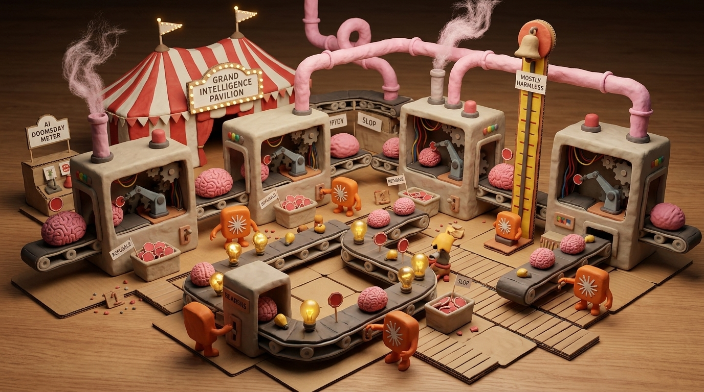
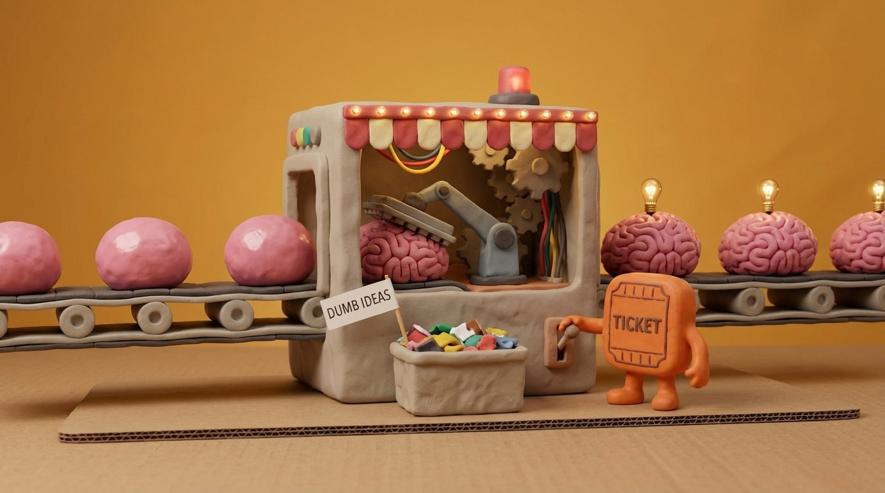
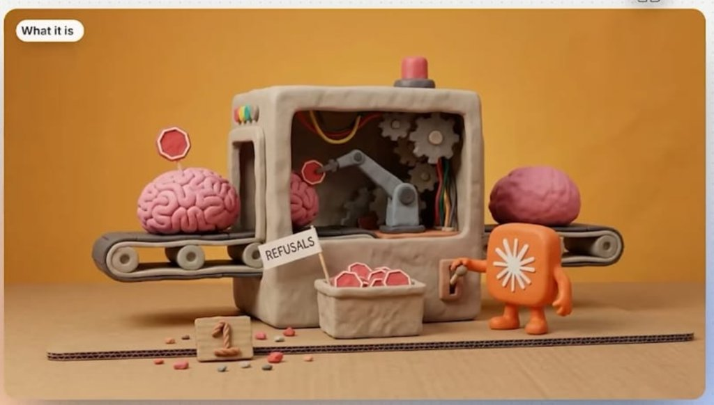
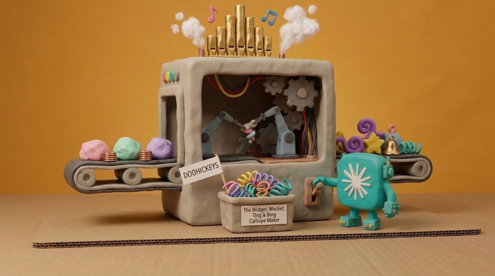
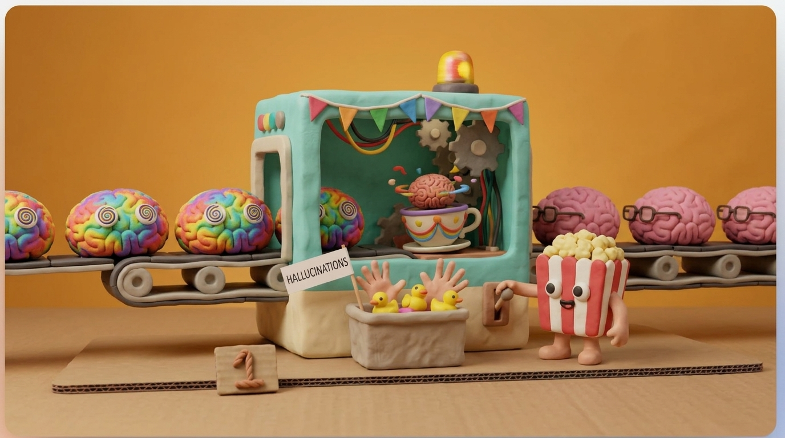
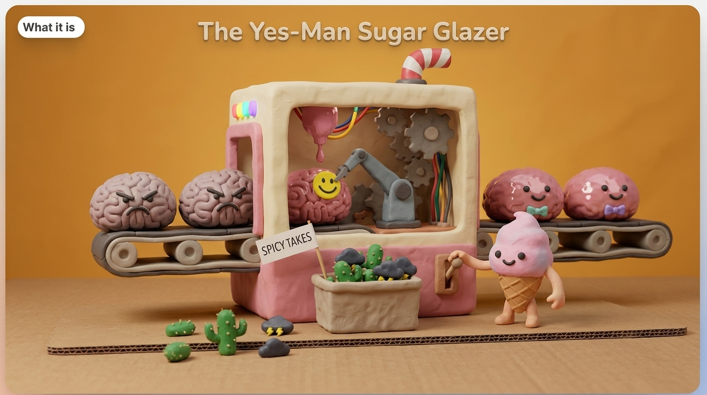
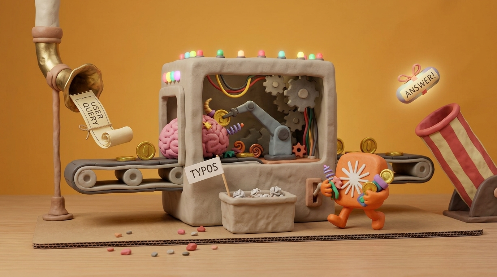
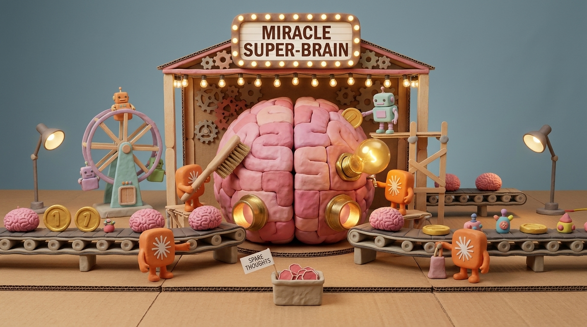

# STORY-002: *Wonder-Think!* — Inside the Miracle Carnival Thinking Box (Game Concept, World Bible & Production Loops)

- **Date**: 2026-11-10
- **Status**: Approved Concept & Theme Canon (Feeds directly into [`STORY-001`](file:///f:/Dev/building-101-game/stories/story-001-machine-framework-and-visual-designer.md) Step 2 & Step 3)
- **Visual Pipeline**: [`docs/3d-machine-asset-pipeline.md`](file:///f:/Dev/building-101-game/docs/3d-machine-asset-pipeline.md)
- **Concept Art Directory**: [`docs/images/wonder-think/`](file:///f:/Dev/building-101-game/docs/images/wonder-think/)

---

## 1. High-Concept Premise: *Inside the "Miracle Computer"*

Outside in the human world sits **"Professor Wonder's Miracle Thinking Engine"**—a towering, flashing carnival cabinet billed as the marvel of the century: *"Ask the Electronic Super-Mind Anything!"* Humans stand in line, half amazed and half terrified that the mysterious AI inside might take over the world.

**Zoom inside the cabinet, and you discover the hilarious truth:**
There is no cold silicon supercomputer inside. Instead, the interior of the "computer" is a sprawling, warm, **stop-motion claymation Fun-Fair & Corrugated-Cardboard Factory** staffed by adorable, earnest, blocky little **Clay AI Mascot Robots**—and **you play as one of them**, running around on stubby clay legs!

1. **Active "Inside-the-Computer" Query Fulfillment**:
   - Brass pneumatic carnival horns drop rolled paper **`USER QUERY`** tickets onto the factory floor (*"Write an excuse for eating my roommate's cake"*, *"Draw a totally normal 5-fingered hand"*, *"Explain quantum physics using onlypirate slang"*).
   - No single item can answer a human prompt on its own! Every response requires assembling just the right hilarious recipe of **Smooth Brains, Wrinkled Brains, Golden Tokens, Widgets, Wockets, Tings, and Bings** and launching them out the striped **`ANSWER!` Cannon**.
   - Early on (or whenever a belt backs up!), you sprint around the boardwalk yourself—scooping shiny **Tokens** out of bins, hand-feeding missing **Wockets** into a sputtering machine, plucking extra stop-signs off an over-cautious brain, and pulling chunky side levers before automating the whole carnival midway!
2. **The Grand Goal — Building the *Miracle Super-Brain***:
   - Why are the little AI robots working so hard? Because at the center of the fairground they are lovingly constructing a colossal, multi-story patchwork clay **`MIRACLE SUPER-BRAIN`**—complete with popsicle-stick scaffolding, miniature Ferris-wheel lifts, giant scrub brushes, and glowing marquee bulbs.
   - Far from plotting humanity's doom, the robots hope that once the Super-Brain grows big enough, it will finally explain *why humans ask 400 questions a day about sourdough starter and cat horoscopes*—unlocking new fairground districts, roller-coaster belt tiers, and whackier gizmo booths along the way.
3. **Tone — Relaxed Sandbox Comedy**:
   - Zero game-over timers, zero punishing stress. Failed or garbled outputs simply result in hilarious comedy replies (*"Your answer shipped with 7 fingers and a rubber duck—the humans think it's avant-garde art!"*), and overflowing byproduct baskets (`"DUMB IDEAS"`, `"REFUSALS"`, `"HALLUCINATIONS"`, `"DOOHICKEYS"`, `"TYPOS"`) never blow up your park—they just wait cheerfully to be emptied or routed into silly carnival sideshows for bonus Wonder Tickets.

---

## 2. The Claymation Item Taxonomy: Brains, Tokens, Widgets, Wockets, Tings & Bings

Instead of grim iron ore, copper ingots, and steel beams, every belt item is a tactile, colorful plasticine toy (<300 triangles, rendered via `THREE.InstancedMesh` with our shared thumbprint clay shader):

| Category | Item Name | Visual Look on Roller Belts | Role in Answering Queries & Building the Super-Brain |
|---|---|---|---|
| **Raw Thought** | **Smooth Brain** | Shiny, completely unwrinkled pink clay blob (`0 IQ`, very aerodynamic). | Extracted from **Bubblegum Putty Vats**; base substrate for all thinking. |
| **Refined Smarts** | **Wrinkled Brain** | Deeply grooved pink clay brain topped with a glowing warm lightbulb. | Stamped in the **Wrinkle-O-Matic Press**; core unit of reasoning. |
| **Verified Smarts** | **Bespectacled Brain** | Tidy pink brain wearing tiny sensible clay reading glasses. | Spun clean in the **Hallucination Tilt-A-Whirl** for factual queries. |
| **Polite Smarts** | **Sugar-Glazed Brain** | Glossy frosted brain with a big smile and pastel bow-tie. | Glazed in the **Yes-Man Sugar Glazer** for customer-service & pep-talk queries. |
| **Safe Smarts** | **Guarded Brain** | Wrinkled brain with just the right number of tiny red octagon stop-signs. | Tuned by the **Refusal Stamper / Plucker** so answers stay family-friendly. |
| **Currency / Fuel** | **Shiny Token** | Chunky embossed gold clay carnival coin (`"1"`). | Minted from raw clay slugs; inserted alongside brains into **Response Booths** to string words together! |
| **Gizmo Parts** | **Widget** | Bright yellow 5-point chunky clay star-gear. | Structural logic piece required for math, code, and listicle queries. |
| **Gizmo Parts** | **Wocket** | Whimsical curly purple Seussian clay horn/twist. | Creative flair piece required for poems, stories, and wild hypotheticals. |
| **Gizmo Parts** | **Ting** | Bouncy teal clay coil-spring. | Snappy timing piece that speeds up punchlines and multi-part answers. |
| **Gizmo Parts** | **Bing** | Shiny miniature brass carnival bell. | Attention-grabbing chime required for "Aha!" moments and Super-Brain milestones! |

### Comedic Byproduct Baskets (With Dynamic Toothpick Flags)
Every processing booth ejects leftover quirks into an open clay basket out front with a dynamic `CanvasTexture` flag:
- **`DUMB IDEAS`** (squished rainbow clay scraps from the *Wrinkle-O-Matic Press*)
- **`REFUSALS`** (excess tiny red clay stop-signs from the *Refusal Plucker*)
- **`HALLUCINATIONS`** (6-fingered clay hands & tiny yellow rubber ducks from the *Tilt-A-Whirl*)
- **`SPICY TAKES`** (prickly green clay cacti & tiny thunderclouds from the *Yes-Man Sugar Glazer*)
- **`DOOHICKEYS`** (tangled rainbow springs from the *Widget/Wocket Calliope Maker*)
- **`TYPOS`** (crumpled little clay paper balls from the *Query-to-Response Booth*)

---

## 3. Core Machine Showcase & Concept Art Reference

### 3.1 Starter Chain Machine 1: *The Wrinkle-O-Matic Brain Press*

- **Inputs**: `Smooth Brain` (belt-in)
- **Interior Cutaway Action**: Articulated waffle-iron rolling press stamps deep IQ folds while chunky clay gears spin under a red-and-cream carnival marquee awning.
- **Outputs**: `Wrinkled Brain` (belt-out) + `DUMB IDEAS` (front basket).
- **Selectable Modes**: *Gentle Crinkle* (low power, zero scrap), *Deep- Dish Genius* (fast wrinkles, more `DUMB IDEAS`), *Brainstorm Overdrive* (sparks extra Golden Lightbulbs).

### 3.2 Starter Chain Machine 2: *The Refusal Stamper & Plucker*

- **Inputs**: `Wrinkled Brain` (belt-in)
- **Interior Cutaway Action**: Articulated grey clay robot arm either stamps red stop-signs onto reckless brains or plucks excess stop-signs off overly timid brains.
- **Outputs**: `Guarded Brain` (belt-out) + `REFUSALS` stop-signs (front basket).
- **Selectable Modes**: *Paranoid PR Mode* (stamps 3 stop-signs on everything), *Balanced Common Sense* (plucks excess signs cleanly), *Hold My Popcorn Mode* (plucks every stop-sign straight into the basket).

### 3.3 Gizmo Foundry: *The Widget, Wocket, Ting & Bing Calliope Maker*

- **Inputs**: `Raw Clay Lumps` + `Copper Coils` (belt-in) + optional `Hype Vapor` (pipe-in).
- **Interior Cutaway Action**: Dual robot arms twist and stamp whimsical parts while golden roof calliope pipes puff cotton-wool steam and floating clay musical notes!
- **Outputs**: Selectable mode crafts `Widgets`, `Wockets`, `Tings`, or `Bings` (belt-out) + `DOOHICKEYS` (front basket).

### 3.4 Quality & Tone Machines: *Hallucination Tilt-A-Whirl* & *Yes-Man Sugar Glazer*

- **Hallucination Tilt-A-Whirl**: Spins dizzy tie-dye brains inside a carnival teacup until tidy `Bespectacled Brains` exit, flinging 6-fingered hands and rubber ducks into `HALLUCINATIONS`.
- **Yes-Man Sugar Glazer**: Drizzles glossy pink frosting and sticks smiley badges onto grumpy brains to produce `Sugar-Glazed Brains`, tossing prickly cacti into `SPICY TAKES`.

### 3.5 Active Player Hub: *The Query-to-Response Carnival Booth*

- **How It Plays**: Brass pneumatic chutes drop `USER QUERY` scrolls with visual part icons (e.g., `1 Wrinkled Brain + 3 Shiny Tokens + 1 Curly Wocket + 1 Brass Bing`).
- Players can belt those ingredients straight into the booth **or** run up on foot carrying armfuls of missing **Tokens, Widgets, and Wockets** to toss right into the side hopper—firing a ribbon-wrapped `ANSWER!` capsule out the striped carnival cannon!

### 3.6 Park Centerpiece: *The Grand Miracle Super-Brain Pavilion*

- **How It Plays**: Converging roller-coaster belts feed surplus Brains, Tokens, Lightbulbs, Widgets, Wockets, Tings, and Bings into brass intake trumpets around the colossal patchwork **Miracle Super-Brain**.
- Each completed tier adds new clay lobes, spinning gears, marquee lights, and tiny helper robots on Ferris-wheel lifts—unlocking new carnival machines and hilarious "AI Doomsday High-Striker" comedy headlines from the amazed human crowd outside (*"LOCAL THINKING BOX WRITES LIMERICK; MAYOR PREEMPTIVELY UNPLUGS TOASTER"*).

---

## 4. Direct Mapping to `STORY-001` Step 2 Implementation

Per user confirmation, **Step 2** of [`STORY-001`](file:///f:/Dev/building-101-game/stories/story-001-machine-framework-and-visual-designer.md) will adopt **Wonder-Think!** directly as its starter machine & item dataset:
1. **Starter Item Set (`QFactoryItemTypes`)**: `smooth-brain`, `wrinkled-brain`, `guarded-brain`, `shiny-token`, `widget`, `wocket`, `ting`, `bing`, plus basket byproducts (`dumb-ideas`, `refusals`, `doohickeys`, `typos`).
2. **First Playable 3D Production Chain**:
   - `putty-vat-extractor.json` (*Bubblegum Putty Vat* → outputs `smooth-brain`)
   - `wrinkle-press-mk1.json` (*Wrinkle-O-Matic Brain Press* → `smooth-brain` → `wrinkled-brain` + `DUMB IDEAS` basket)
   - `refusal-stamper-mk1.json` (*Refusal Stamper / Plucker* → `wrinkled-brain` → `guarded-brain` + `REFUSALS` basket)
   - `calliope-gizmo-maker.json` (*Widget, Wocket, Ting & Bing Calliope* → multi-mode selector for `widget` / `wocket` / `ting` / `bing` + `DOOHICKEYS` basket)
   - `query-response-booth.json` (*Query-to-Response Booth* → combines brains + tokens + gizmos into `ANSWER!` launches, supporting both automated belt feed and walk-up manual player insertion)
3. **Dual Visual Mode Support Retained 100%**:
   - Every carnival machine still defines both a fast **Simple Framework (`blockout`)** representation for layout/socket testing and a **Detailed Claymation Cutaway (`detailed`)** representation exportable to `.glb` for Three.js & Godot 4.
