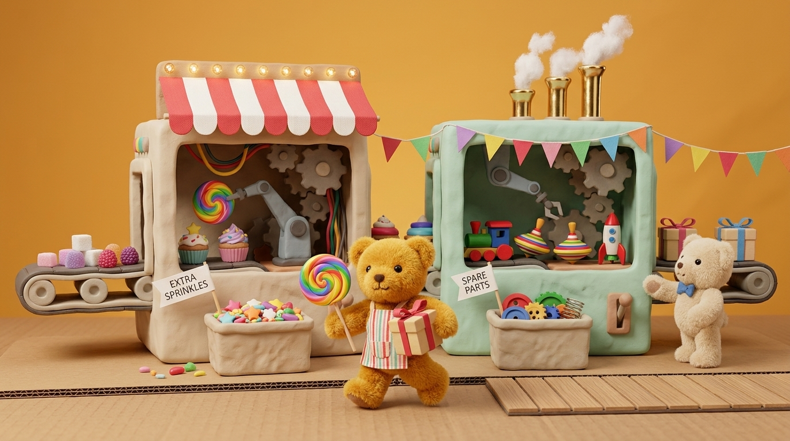

# STORY-003: *Teddy's Sweetshop & Wonder-Toy Factory* — Playable Prototype & Claymation-Plus-Plush 3D Model Pipeline

- **Date**: 2026-11-10
- **Status**: Implemented Prototype (`Step 2` Active Showcase)
- **Visual Reference**: [`docs/images/teddy-sweet-toy-factory.jpg`](file:///f:/Dev/building-101-game/docs/images/teddy-sweet-toy-factory.jpg)
- **Related Framework**: [`STORY-001`](file:///f:/Dev/building-101-game/stories/story-001-machine-framework-and-visual-designer.md), [`docs/3d-machine-asset-pipeline.md`](file:///f:/Dev/building-101-game/docs/3d-machine-asset-pipeline.md)

---

## 1. Active Game Concept

Players control a **fluffy golden plush Teddy-Bear** (`WASD` / Arrow keys) running around a warm tabletop **Corrugated-Cardboard & Carnival Workshop**, harvesting natural sweets and toy materials to craft lollipops, cupcakes, cogs, wheels, widgets, classic wooden/tin toys, and ribbon-tied **Gift Boxes**!

---

## 2. Resource Biomes & Production Chains

1. **Resource Patches & Rainbow Color River** ([`QFactoryResourceNodes.ts`](file:///f:/Dev/building-101-game/src/core/QFactoryResourceNodes.ts)):
   - **Sugar-Crystal Patch** (`sugar-cube`) — harvested by `sugar-harvester.json`
   - **Rainbow Color River & Prism Pools** (`rainbow-dye`) — siphoned by `color-extractor.json`
   - **Toymaker Timber Grove** (`wood-block`) — harvested by `sugar-harvester.json`
   - **Clockwork Brass Vein** (`tin-ingot`) — harvested by `sugar-harvester.json`
2. **Sweetshop Wing** ([`sweet-maker.json`](file:///f:/Dev/building-101-game/src/data/machines/sweet-maker.json)):
   - *Rainbow Swirl Lollipops*: `1x sugar-cube + 1x rainbow-dye → swirl-lollipop` (+ `EXTRA SPRINKLES` basket)
   - *Frosted Star Cupcakes*: `1x sugar-cube → star-cupcake` (+ `EXTRA SPRINKLES` basket)
3. **Gizmo & Parts Wing** ([`part-lathe.json`](file:///f:/Dev/building-101-game/src/data/machines/part-lathe.json)):
   - *Painted Toy Wheels*: `1x wood-block → wheel`
   - *Clockwork Brass Cogs*: `1x tin-ingot → cog`
   - *Rainbow Star Widgets*: `1x tin-ingot + 1x rainbow-dye → widget`
4. **Wonder-Toy Assembly** ([`toy-assembler.json`](file:///f:/Dev/building-101-game/src/data/machines/toy-assembler.json)):
   - *Wooden Choo-Choo Train*: `1x wheel + 1x cog → toy-train`
   - *Carnival Spinning Top*: `1x wood-block + 1x rainbow-dye → spinning-top`
   - *Wind-Up Tin Rocket*: `1x widget + 1x cog → toy-rocket`
5. **Ribbon Gift-Box Wrapping** ([`gift-wrapper.json`](file:///f:/Dev/building-101-game/src/data/machines/gift-wrapper.json)):
   - *Deluxe Toy + Sweet Gift Box*: `1x Toy + 1x Sweet → gift-box` (2x Gift Box Celebration Credit!)
   - *Express Single Gift Wrap*: `1x Any Toy or Sweet → gift-box`

---

## 3. How the 3D Models Are Built to Match the Artwork (< 3,500 Tris / Machine)

| Artwork Element | 3D Procedural / `.glb`-Ready Implementation | Core Module |
|---|---|---|
| **Tactile Thumbprint Clay vs. Fuzzy Plush Fur** | Cached procedural 64×64 bump textures (`getClay` at `roughness: 0.88` vs. `getPlush` high-frequency fuzzy bump at `roughness: 0.96`). | [`QFactoryClayMaterialLibrary.ts`](file:///f:/Dev/building-101-game/src/core/QFactoryClayMaterialLibrary.ts) |
| **Open-Front Cutaway Window & Carnival Awnings** | Cached `THREE.ExtrudeGeometry` outer rounded rectangle with inner rounded window `THREE.Path` hole (`curveSegments: 4`), striped red-and-cream marquee awnings, pastel bunting, and golden calliope stacks. | [`QFactoryCutawayShellBuilder.ts`](file:///f:/Dev/building-101-game/src/core/QFactoryCutawayShellBuilder.ts) |
| **Whirring Clay Gears, Wires & Robotic Arms** | Parametric toothed cog extrusions (`anim_gear_1..3`), `CatmullRomCurve3` colored wire tubes, 2-joint robotic arm (`anim_arm_base` → `anim_arm_upper`), and interior display toys/sweets. | [`QFactoryCutawayInteriorBuilder.ts`](file:///f:/Dev/building-101-game/src/core/QFactoryCutawayInteriorBuilder.ts) |
| **Filling Clay Baskets, Toothpick Flags & Roller Belts** | 5-wall sculpted front basket stacking 12 colorful sprinkles/cogs proportional to `basketCount / capacity`, pooled HTML5 `CanvasTexture` toothpick flags (`EXTRA SPRINKLES`, `SPARE PARTS`), and side-roller conveyor tracks. | [`QFactoryBasketAndSignBuilder.ts`](file:///f:/Dev/building-101-game/src/core/QFactoryBasketAndSignBuilder.ts) |
| **Fluffy Plush Teddy-Bear Characters** | Articulated plush teddy (`anim_leg_l/r`, `anim_arm_l/r`, `teddy_head`) in two variants: `player-apron` (holding swirl lollipop & gift box) and `helper-bowtie` beside machine levers. | [`QFactoryTeddyBuilder.ts`](file:///f:/Dev/building-101-game/src/core/QFactoryTeddyBuilder.ts) |
| **Rising Cotton-Wool Steam Puffs** | Single global `THREE.InstancedMesh` emitting soft white matte puffs from active brass smokestacks when `spinRatio > 0.25`. | [`QFactorySmokeSystem.ts`](file:///f:/Dev/building-101-game/src/core/QFactorySmokeSystem.ts) |
